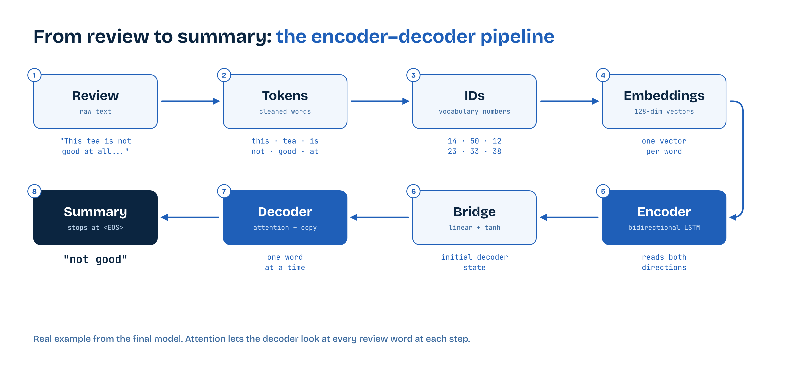
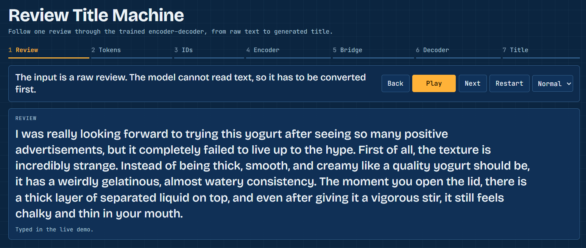
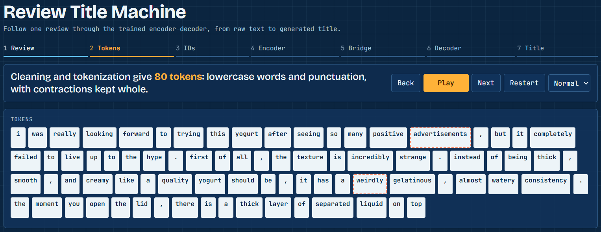
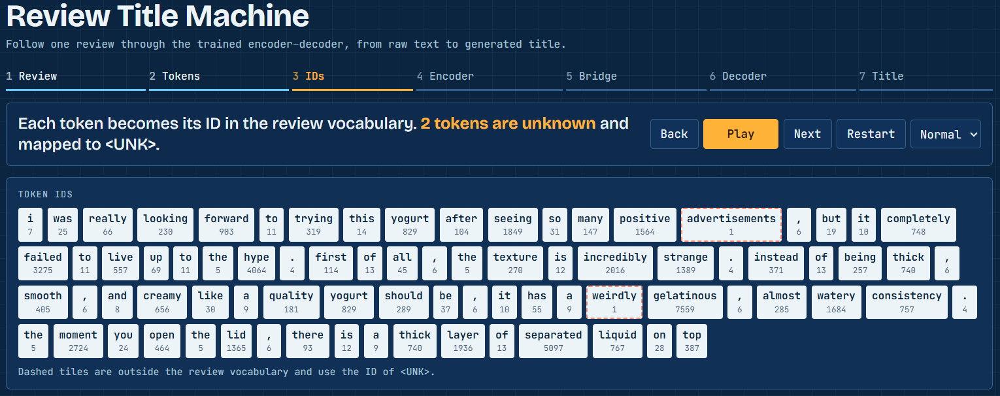
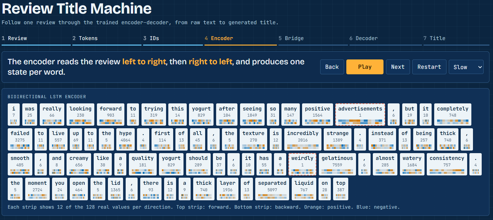
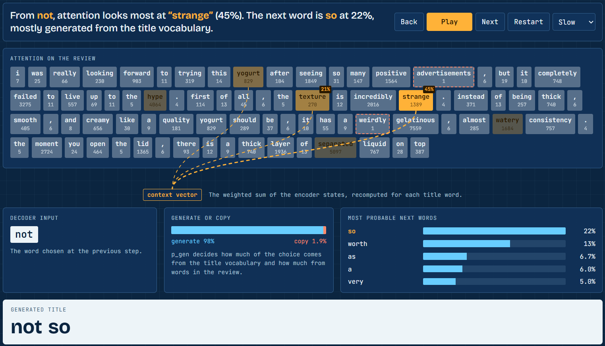
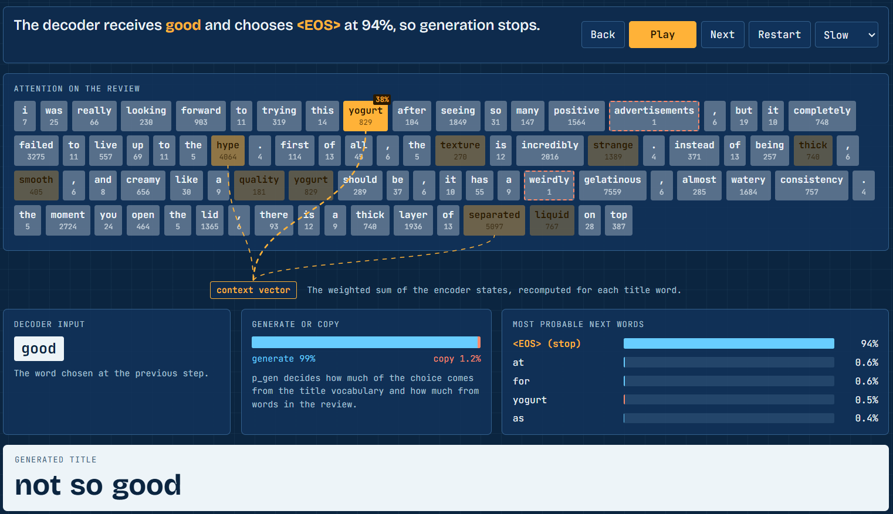
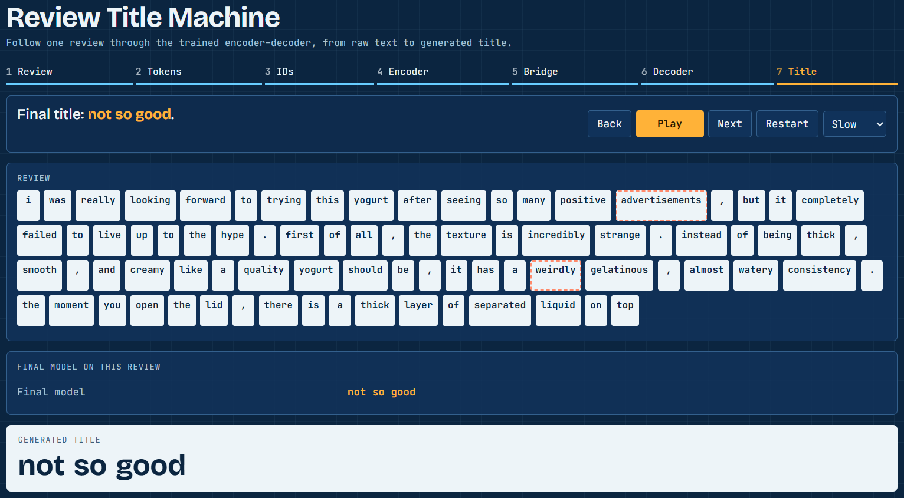
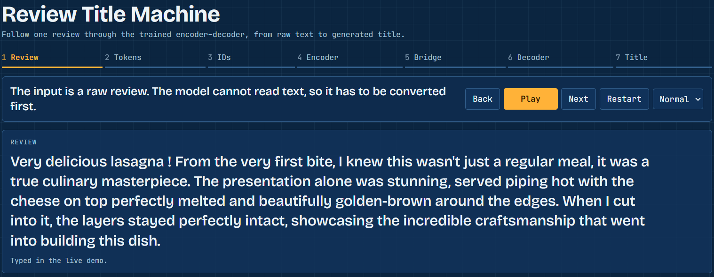
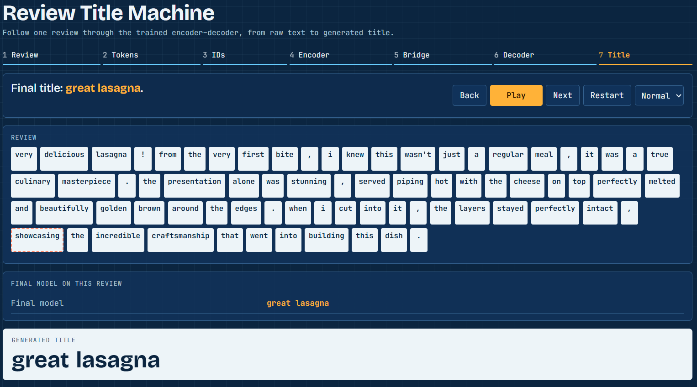

# Review Title Generation: Text Summarization with Encoder-Decoder Models

NLP course project by Omar Belhaj, Université Paris Dauphine-PSL.

**This is a text summarization task.** The model reads an Amazon food review and writes a short title that summarizes it in a few words, keeping both the subject and the opinion. This is extreme abstractive summarization: the summary is around 3 words long, and the model generates it word by word instead of copying a sentence from the review.

## Architecture



Read the full [report](Report.pdf) and the [presentation](Presentation.pdf) for the dataset, architecture, training procedure, results and limitations.

```
Review   : This tea is not good at all. It tastes like nothing and I would not recommend it.
Summary  : not good
```

The encoder–decoder pipeline (tokenization, vocabulary, embeddings, BiLSTM encoder, attention, pointer-generator decoder, training and evaluation) is implemented and trained from scratch in PyTorch. No pretrained generative model is used.

## Why it is useful

- **Faster reading.** A few words summarize a long review, so a shopper or an analyst can scan hundreds of reviews at a glance.
- **Missing titles.** Platforms can suggest a title when a customer leaves it empty or writes a vague one.
- **Customer insight.** Short summaries are easy to group and count, for example to find the most frequent complaints about a product.
- **A transferable method.** The same pipeline applies to other short summaries: email subject lines, support ticket titles or news headlines.

## Demo

Here's an example of a negative review of a yogurt :  
The raw review written by the customer, as the model receives it.

<p align="center">
  
</p>

The review is cleaned and split into tokens, each token is replaced by its number in the vocabulary, because the model only works with numbers, and unknown words become `<UNK>`.

<p align="center">
  
  
</p>

A bidirectional LSTM reads the review left to right and right to left, and produces one state per word that captures its context.
A small layer turns the encoder’s final state into the starting state of the decoder.

<p align="center">
  
  
</p>

The decoder writes the title one word at a time, starting from `<SOS>`, using attention to focus on the most useful review words and choosing between generating a word or copying one from the review.
Generation stops when the model produces `<EOS>`, and the chosen words form the final summary.

<p align="center">
  
  
</p>

Now, an example of a positive review of a lasagna :

<p align="center">
  
  
</p>

Here's a demo video of the lasagna example : 


https://github.com/user-attachments/assets/7ca19468-1f28-4c2b-8df4-1faab0834225


## Results on the test set

| Model | ROUGE-1 | ROUGE-2 | BLEU-2 | Distinct titles | Sentiment balanced accuracy |
| --- | ---: | ---: | ---: | ---: | ---: |
| Most frequent title (no learning) | 0.066 | 0.011 | 1.26 | 0.0% | 0.500 |
| First 4 words of the review (no learning) | 0.094 | 0.028 | 4.84 | 85.9% | 0.635 |
| LSTM baseline | 0.105 | 0.021 | 3.03 | 0.5% | 0.822 |
| LSTM + attention | 0.153 | 0.042 | 5.76 | 16.7% | 0.753 |
| BiLSTM + attention | 0.159 | 0.043 | 6.11 | 23.1% | 0.754 |
| **Final model: BiLSTM + attention + copying + balanced sampling + 150,000 reviews** | **0.183** | **0.057** | **7.40** | **41.9%** | **0.830** |

- Attention is the architecture choice with the clearest effect.
- More training data is the strongest single improvement.
- The bidirectional encoder and beam search bring no clearly established gain.
- Each model was trained once, so small differences are not established.

A manual review of 50 random test summaries from a second run of the final model judged 40 acceptable, 10 of them generic, against a mean ROUGE-1 of 0.198 on those reviews. ROUGE both misses valid summaries and rewards wrong ones.

Remaining weaknesses include contrast ("terrible taste" for a tasty product), repetition, and generic summaries.

## Repository

| Path | Content |
| --- | --- |
| `notebook/` | Complete pipeline. Sections 1 to 10 keep the outputs of the first run. Later sections were run separately, and their outputs are in `results/` |
| `demo/index.html` | Animated walk-through of the model's decoding steps. Open it in a browser |
| `demo/demo_app.py` | Live Gradio demo: type a review and follow it through the same animated page, with values computed live |
| `model/` | Weights of the final model (second training run), vocabularies and configuration |
| `results/` | Metrics, run outputs, figures and the manual annotation |
| `scripts/` | Rebuilds the manual annotation sheet without training |
| `Report.pdf` | Short LaTex report |
| `Presentation.pdf` | Canva presentation of the project |
| `docs/screenshots/` | Demo screenshots used above |

## Run it

**Animated demo:** open `demo/index.html` in a browser.

**Live demo**, from the repository root:

```bash
pip install -r requirements.txt
python demo/demo_app.py
```

This prints a temporary public link created by Gradio.

**Full training:** open the notebook on Kaggle or Colab with a GPU, then run all cells. The dataset is not included in this repository. On Kaggle, add [Amazon Fine Food Reviews](https://www.kaggle.com/datasets/snap/amazon-fine-food-reviews) as an input. On Colab it is downloaded automatically. A new run can give slightly different numbers.

## Data

Amazon Fine Food Reviews (McAuley & Leskovec, 2013). Each review comes with the title its author wrote, which serves as the reference summary. The split is made by product, so test products are never seen during training.
